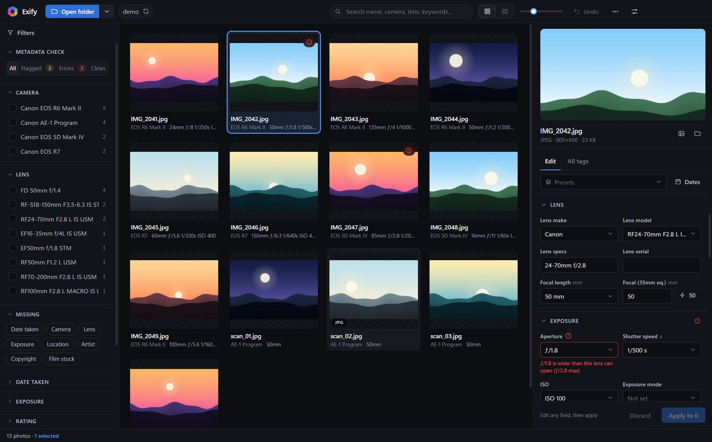
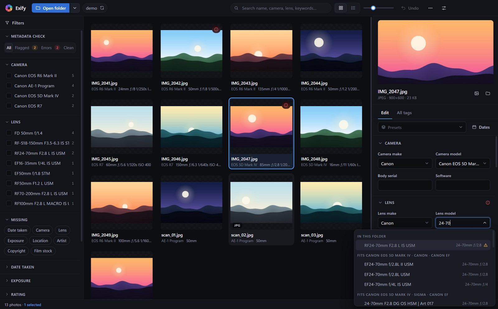
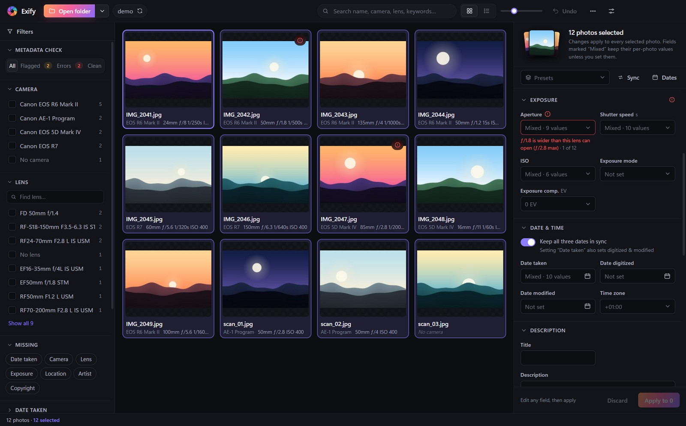

<p align="center">
  
  
</p>

<p align="center"><b>Fast batch EXIF editor for whole folders of photos.</b><br>
Camera & lens dropdowns, mismatch detection, film-log import, GPX geotagging, renaming and undo. For JPEG, HEIC, TIFF, PNG and RAW.</p>

<p align="center">
  <a href="https://github.com/wrrnstrpn/exify/releases/latest">Download</a> ·
  <a href="#features">Features</a> ·
  <a href="#building-from-source">Build from source</a>
</p>

<p align="center"></p>

## Download

Grab the latest build from [Releases](https://github.com/wrrnstrpn/exify/releases/latest):

| | File | Notes |
| --- | --- | --- |
| Windows | `Exify-Setup-x.y.z.exe` | Installs for your user only, no admin rights needed. ExifTool is bundled. |
| macOS | `Exify-x.y.z-arm64.dmg` (Apple silicon) or `-x64.dmg` (Intel) | Uses the Perl that ships with macOS. |
| Linux | `Exify-x.y.z-x86_64.AppImage` or `exify_x.y.z_amd64.deb` | Needs `perl`, which nearly every distro has. |

Installed copies check GitHub for new versions on startup and install them when you quit. You can turn that off in Settings.

> **Unsigned builds:** the apps aren't code-signed yet. On Windows, SmartScreen may say *"Windows protected your PC"*: click **More info → Run anyway**. On macOS, right-click the app and choose **Open** the first time. macOS also can't install updates for unsigned apps, so there Exify tells you a new version is out and links to it instead.

Exify writes metadata into your files. **Keep backup copies** is on by default: the untouched original is kept next to each edited file as `name.jpg_original`, and **Backups…** in the tools menu can put those back or clear them out. Undo also works for every change during a session. RAW files are left alone: their edits go into an XMP sidecar (see below).

## Features

- **Open a whole folder** (subfolders optional) and get a virtualized grid or sortable list of every photo, with thumbnails for JPEG, HEIC and RAW (from Windows' shell or the embedded RAW preview).
- **Batch editing.** Select one photo or thousands. Fields where the selection differs show as *Mixed* and are left alone unless you set them. Only files whose values actually change get written.
- **Camera & lens dropdowns.** Searchable lists of about 700 bodies and 900 lenses, film bodies included. They use the exact strings cameras write to EXIF (e.g. Sony `ILCE-7M4` is shown as *α7 IV*), so Lightroom profiles still match. Canon is covered in depth:
  - every EOS R, RF-S, 1D/5D/6D/7D, xxD, Rebel/Kiss (all regional names) and EOS M body, plus Canon film EOS & FD
  - near-complete RF, RF-S, EF, EF-S, EF-M and FD lens lines, including teleconverter combos
- **Smart linking.** Picking a lens fills in the lens maker. Picking a prime also fills in the focal length. The 35 mm-equivalent focal length is worked out from the body's crop factor (1.6× APS-C, 1.3× APS-H, …).
- **Mismatch detection.** A ⚠/⛔ marker appears next to the field, in the dropdown options and on the thumbnail:
  - an aperture wider than the lens allows (checked at the actual focal length on variable-aperture zooms)
  - a focal length outside the lens range, or a different focal length on a prime
  - a lens that can't mount on the body (RF on an EF DSLR, EF-S on full frame or on the EOS 10D, …)
  - a camera model paired with the wrong make, or a lens with the wrong lens maker
  - a 35 mm-equivalent focal length that doesn't match the crop factor
  - bad shutter speeds, future dates, invalid time zones or GPS
- **Filters:** search, camera, lens, folder, file type, date range, ISO, focal length and aperture ranges, rating, *missing* fields (no date, no GPS, …) and *flagged / errors / clean*.
- **Date tools:** shift by an offset to fix a wrong camera clock, sequence dates in on-screen order (useful for film scans), or set each photo's time zone from its GPS position, daylight saving included.
- **XMP sidecars for RAW.** Edits to CR3, NEF, ARW, RAF and other RAW files go into `IMG_0001.xmp` next to the file, the way Lightroom, Capture One and darktable expect, so the RAW itself is never rewritten. Existing sidecars (either naming style) are read and kept up to date. You can switch this off in Settings.
- **Import a CSV or shooting log.** Map spreadsheet columns to fields (common names like *f-stop*, *Shutter*, *Film stock* and *Notes* are recognised), then match rows to photos by file name, frame number (`Scan_012.jpg` is frame 12) or order. Shutter speeds are read the way they're written on a dial, so `125` means 1/125. There's a preview before anything is written.
- **Geotag from GPX.** Load one or more tracks from a phone, watch or logger. Photos are matched by time, with a time zone and a camera-clock correction, and you see the track and the matched photos on a map first.
- **Map.** See where the visible photos were taken, or click to pick a location for the selected ones.
- **Rename files** from a pattern like `{YYYY}-{MM}-{DD}_{camera}_{n:3}`, with a live preview. Clashes get a `-2` suffix, sidecars and backups move along, and it can be undone.
- **Compare** two to four photos field by field. With two, copy any differing value across with one click.
- **Film fields:** film stock (with a list of common stocks) and push/pull, stored in XMP.
- **Location names:** place, city, state and country, written to both XMP and IPTC. Lens serial number and lens specs (`24-70mm f/2.8`, filled in from the lens) too.
- **Presets** for gear combos, **Sync** fields from the focused photo, keywords that can be added to or removed from a whole batch, a ★ rating, GPS (paste `lat, lon`), copyright helper.
- **Safety:** backups on by default, sidecars for RAW, undo for every write and rename in the session, and file modified dates are preserved.
- **All tags** inspector, **CSV export**, lightbox preview, and drag & drop to open a folder.

<table>
  <tr>
    <td></td>
    <td></td>
  </tr>
  <tr>
    <td align="center"><sub>Lenses that fit the body come first; ones that don't are flagged.</sub></td>
    <td align="center"><sub>Batch-edit any number of photos at once.</sub></td>
  </tr>
</table>

### Keyboard

| Keys | Action |
| --- | --- |
| `Ctrl+O` | Open folder |
| `Ctrl+A` / `Esc` | Select all visible / clear selection |
| Click, `Ctrl`+click, `Shift`+click, arrows | Select |
| `Space` / double-click | Preview |
| `Ctrl+Enter` | Apply edits |
| `Ctrl+Z` | Undo last change |
| `F2` | Rename selected files |
| `Ctrl+F` | Search |
| `F5` | Rescan folder |

On macOS use `Cmd` wherever it says `Ctrl`.

## About the gear database

The camera and lens lists are **best-effort**. Mainstream bodies and lenses (especially Canon, Nikon, Sony and Fujifilm) use the exact model strings those cameras write. Some entries are less certain, such as drone and phone model codes and very recent releases. If you spot a wrong or missing entry, please [open an issue](https://github.com/wrrnstrpn/exify/issues) or a pull request.

Gear you type that isn't in the list is remembered automatically under **My gear**.

Camera and lens names are trademarks of their respective owners. Exify is not affiliated with or endorsed by Canon, Nikon, Sony, Fujifilm or any other manufacturer.

## Building from source

```bash
npm install
npm run dev         # run the app with hot reload
npm test            # unit + ExifTool integration tests
npm run typecheck
npm run dist        # Windows installer into dist/
npm run dist:mac    # .dmg and .zip (run on a Mac)
npm run dist:linux  # AppImage and .deb (run on Linux)
```

Requires Node 20+. Each platform's installer has to be built on that platform.

### Releasing

Bump `version` in `package.json`, commit, and push a matching tag (`git tag v1.1.0 && git push --tags`). The release workflow builds all three platforms and uploads them to a **draft** GitHub release, together with the `latest*.yml` files the auto-updater reads. Check the draft, then publish it.

### Code signing

Builds are unsigned unless these repository secrets exist, in which case the release workflow signs with them:

- **Windows:** `WIN_CSC_LINK` (a base64-encoded `.pfx` code-signing certificate) and `WIN_CSC_KEY_PASSWORD`.
- **macOS:** `MAC_CSC_LINK` (a Developer ID Application certificate as base64 `.p12`) and `MAC_CSC_KEY_PASSWORD`, plus `APPLE_ID`, `APPLE_APP_SPECIFIC_PASSWORD` and `APPLE_TEAM_ID` for notarisation.

Once Windows releases are signed, also set `win.signtoolOptions.publisherName` in `electron-builder.yml` so the updater checks that updates come from the same publisher.

### Project layout

```
src/
  main/        Electron main process: ExifTool engine and undo history, sidecars, renames and backups,
               scan, thumbnails (exify:// protocol), auto-update
  preload/     Typed IPC bridge (window.exify)
  shared/      Field definitions (EXIF tag mapping) and shared types
  renderer/    React UI
    data/      Camera & lens database (mounts, crop factors)
    lib/       Validation, filtering, dropdown options, CSV import, GPX matching, rename patterns, time zones
    components/
tests/         Vitest suites and image fixtures
resources/     Logo & icon sources (SVG) and renders
scripts/       Logo generator/rasteriser and Electron launch helpers
```

To regenerate the logo after editing `scripts/make-logo.mjs`, run `npm run logo`.

### Adding gear

Bodies go in `src/renderer/src/data/cameras.ts` and lenses in `src/renderer/src/data/lenses.ts`. Each entry is `[exifModelString, mount, friendlyLabel?]`. `npm test` checks for duplicates and unknown mounts.

## Credits & licence

Exify is [MIT licensed](LICENSE). It's built on [ExifTool](https://exiftool.org) by Phil Harvey and [exiftool-vendored](https://github.com/photostructure/exiftool-vendored.js) by PhotoStructure. Maps use [Leaflet](https://leafletjs.com) with tiles from [OpenStreetMap](https://www.openstreetmap.org/copyright), and time zones come from [tz-lookup](https://github.com/photostructure/tz-lookup). See [THIRD_PARTY_NOTICES.md](THIRD_PARTY_NOTICES.md) for the bundled software and its licences.
